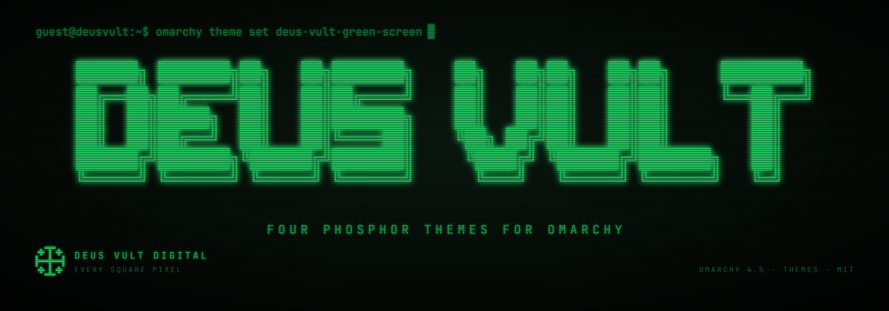
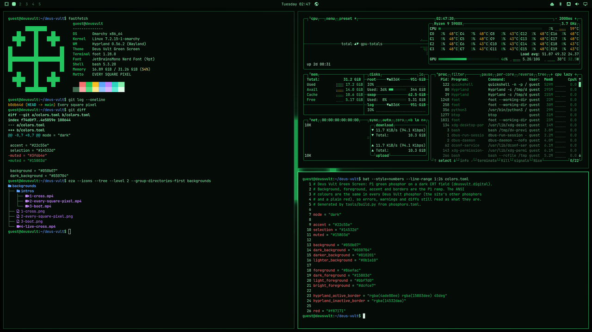
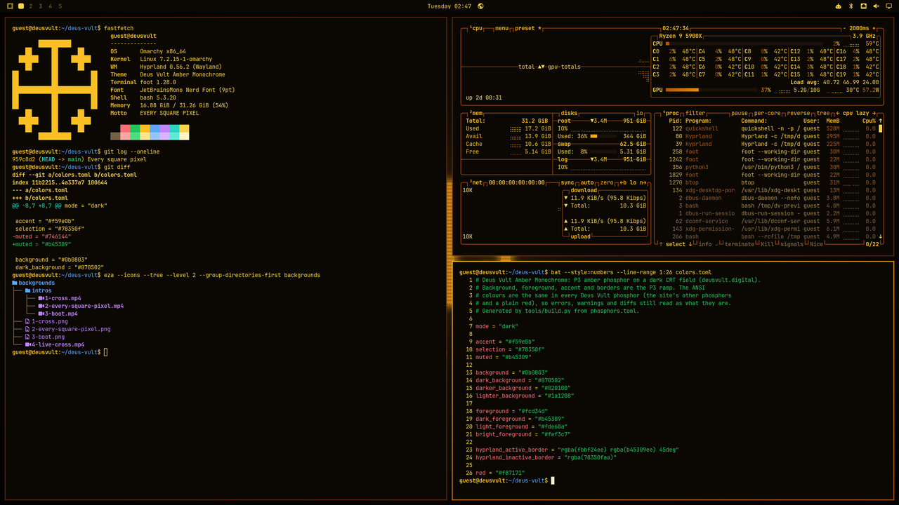
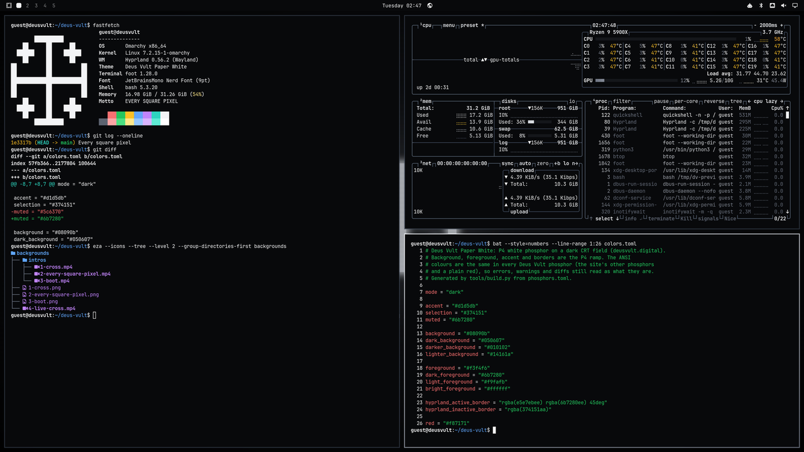
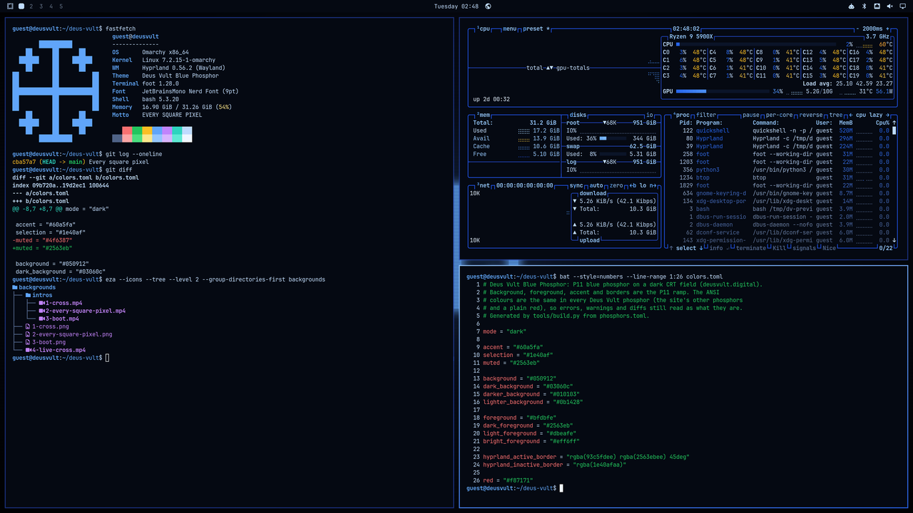

<h1 align="center"></h1>

<p align="center">
  Omarchy 4.5 themes · by <a href="https://deusvult.digital">Deus Vult Digital</a>
</p>

<p align="center">
  <a href="#the-themes">The themes</a> ·
  <a href="#whats-in-each">What's in each</a> ·
  <a href="#building">Building</a> ·
  <a href="#license">License</a>
</p>

Four themes for Omarchy, one for each phosphor of
[deusvult.digital](https://deusvult.digital): the glow of an old monochrome
CRT terminal on a near-black field, kept quiet enough to work in all day.
Errors, warnings and diffs keep their own colours in all four (red, amber,
green, blue), so the terminal still tells you what's what.

Each theme lives in its own repo, since `omarchy theme install` takes one
theme per repo. This repo is where they are made.

## The themes

### Green Screen: P1 green



```sh
omarchy theme install https://github.com/deus-vult-digital/omarchy-deus-vult-green-screen-theme.git
```

### Amber Monochrome: P3 amber



```sh
omarchy theme install https://github.com/deus-vult-digital/omarchy-deus-vult-amber-monochrome-theme.git
```

### Paper White: P4 white



```sh
omarchy theme install https://github.com/deus-vult-digital/omarchy-deus-vult-paper-white-theme.git
```

### Blue Phosphor: P11 blue



```sh
omarchy theme install https://github.com/deus-vult-digital/omarchy-deus-vult-blue-phosphor-theme.git
```

The installer clones a theme into `~/.config/omarchy/themes/deus-vult-<phosphor>`
(e.g. `deus-vult-amber-monochrome`) and switches to it; afterwards it is in the
theme menu (`Super + Ctrl + Shift + Space`) like any other. Install as many as
you like and switch between them.

## What's in each

- **Colours** (`colors.toml`): terminal, editor, bar, launcher, notifications,
  lock screen and window borders, all in the phosphor's ramp.
- **Backgrounds**: the pixel Jerusalem cross, the motto in block letters and a
  boot screen, each with an Omarchy 4.5 intro (the CRT powering on and drawing
  it), plus a live background where the cross breathes under a rolling refresh
  band.
- **Boot and login logo** (`unlock.png`), **btop** and **icons** (the Yaru tint
  closest to the phosphor).

Each theme's README has the details and its palette.

## Building

Everything is generated, nothing downloaded. The phosphors and their colours
are in `phosphors.toml`; the ANSI colours there are shared by all four.

| Script | Does | Needs |
| --- | --- | --- |
| `tools/build.py [phosphor…] [--quick]` | builds each theme into `build/deus-vult-<phosphor>/` and its small preview into `assets/previews/` | Python 3.11, everything below, and the Deus Vult Digital banner generator (`MAKE_BANNER`) |
| `tools/make-backgrounds.py <phosphor>` | `backgrounds/` (stills, intros, the live background) and `unlock.png` | `rsvg-convert`, ImageMagick, ffmpeg, JetBrainsMono Nerd Font |
| `tools/make-preview-unlock.sh <theme folder>` | `preview-unlock.png` | ImageMagick, Omarchy |
| `tools/stage-preview.sh <theme folder>` | `preview.png` | Omarchy 4.5, a Wayland session |
| `tools/publish.sh -m MESSAGE [-p] [phosphor…]` | commits each built theme to its repo and pushes; `-p` also to its public mirror | git |

`--quick` skips the videos and the staged preview, for trying out colours.
`make-backgrounds.py` draws every image and video frame as SVG; `--only NAME`
picks one target, `--at SECONDS` writes single video frames for checking.
`stage-preview.sh` runs a throwaway Omarchy desktop (a nested Hyprland with its
own home, user, host name and no network) on the theme and screenshots it;
your own session is never touched. `templates/README.md` is each theme's README.

To change a theme: edit `phosphors.toml` (or the scripts), run
`tools/build.py <phosphor>`, look at `build/`, then `tools/publish.sh`.

This repo's banner: `make-banner.py --title "Deus Vult" --command "omarchy theme
set deus-vult-green-screen" --tagline "Four phosphor themes for Omarchy" --footer
"OMARCHY 4.5 · THEMES · MIT"`.

## Credits

- `tools/ansi-shadow.flf`: the ANSI Shadow FIGlet font, as shipped in the
  MIT-licensed [figlet](https://github.com/patorjk/figlet.js) package.
- The palettes follow the phosphor colours of [deusvult.digital](https://deusvult.digital).

## License

[MIT](LICENSE) © Deus Vult Digital
